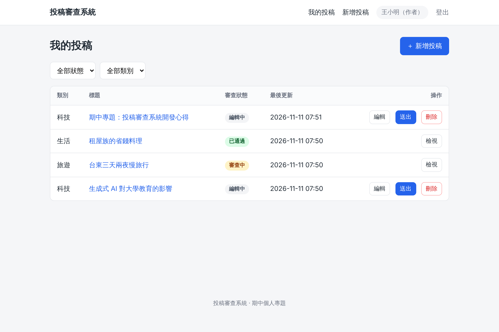
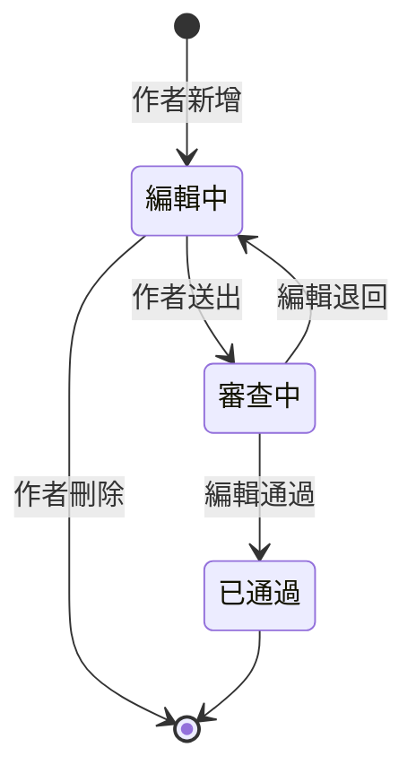
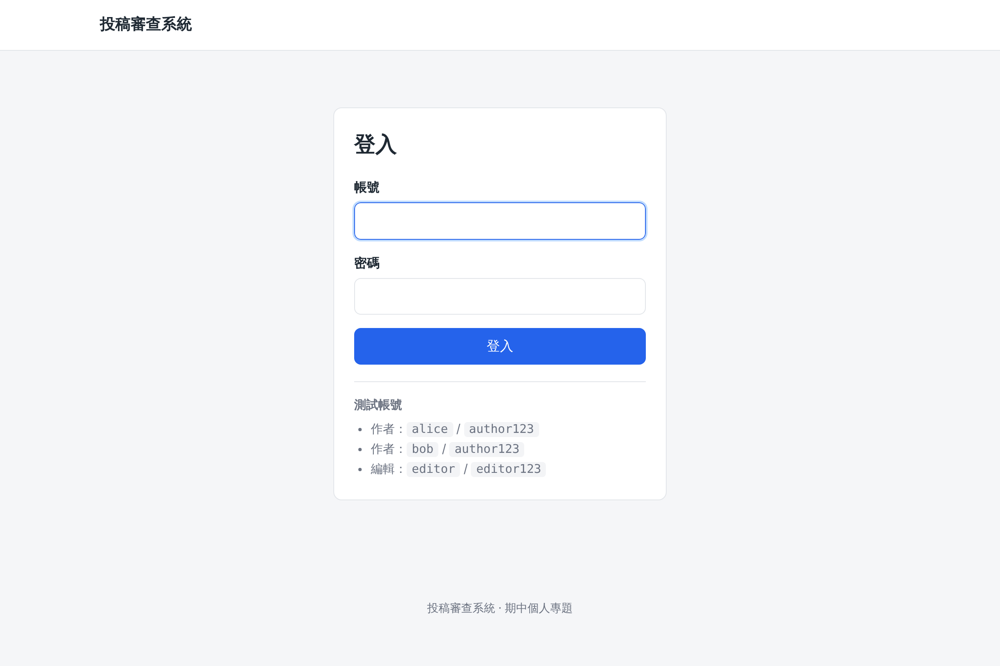
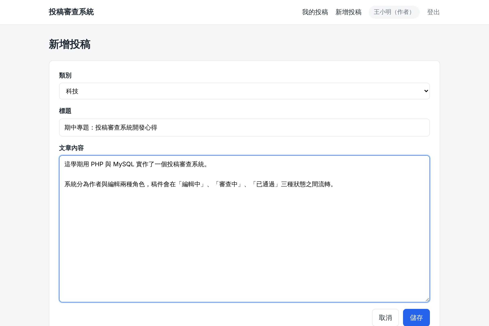
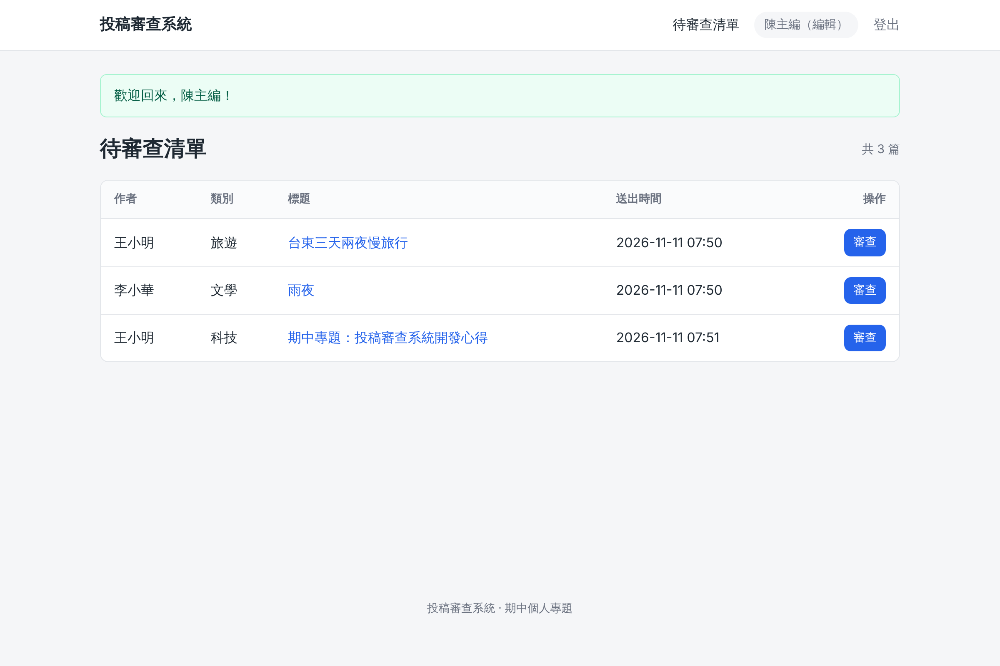
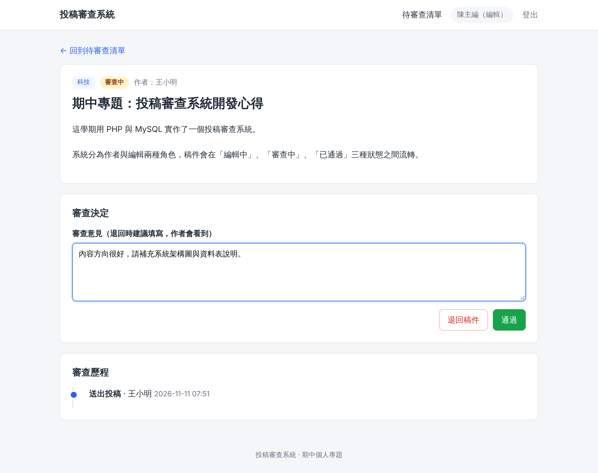
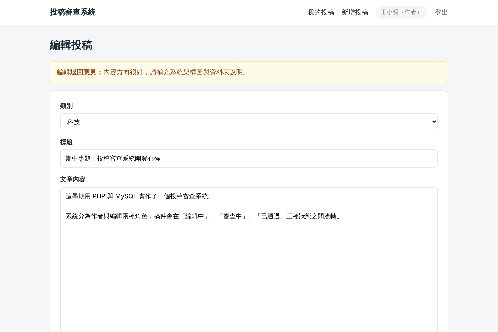
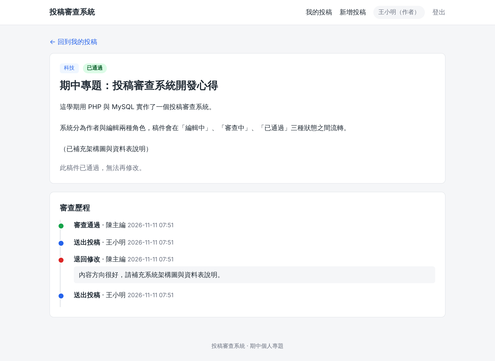
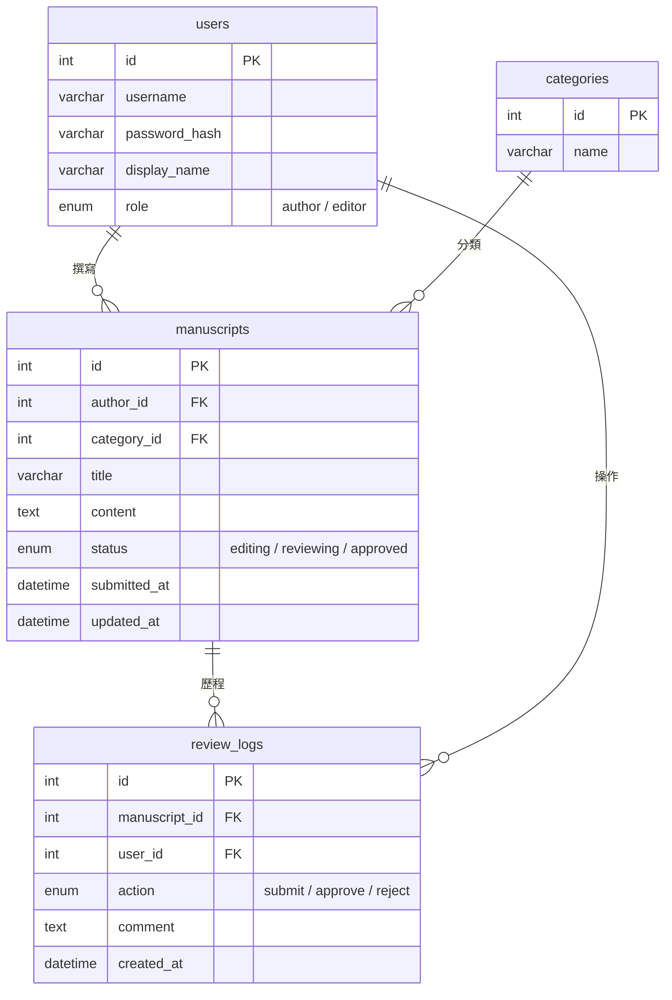

# 投稿審查系統 Submission Review System

以 **PHP + MySQL** 實作的投稿審查系統，提供「作者」與「編輯」兩種角色，完整處理稿件從撰寫、送審、退回修改到審查通過的流程。

> 期中個人專題作品



## 功能

### 作者
- 查看自己的投稿清單（類別、標題、審查狀態），可依狀態與類別篩選
- 新增、編輯投稿（類別、標題、文章內容），新稿件狀態為「編輯中」
- 刪除「編輯中」的稿件
- 送出投稿：編輯中 → 審查中
- 被退回時可看到編輯的審查意見，修改後重新送出

### 編輯
- 查看待審查清單（作者、類別、標題、送出時間）
- 查看稿件內容
- 通過稿件：審查中 → 已通過
- 退回稿件：審查中 → 編輯中，可附上審查意見

### 其他
- 審查歷程：每次送出、通過、退回都會留下紀錄與意見
- 響應式介面，手機也能操作

## 稿件狀態流程



| 狀態 | 作者可以 | 編輯可以 |
|---|---|---|
| 編輯中 | 編輯、刪除、送出 | （看不到草稿） |
| 審查中 | 檢視 | 檢視、通過、退回 |
| 已通過 | 檢視 | 檢視 |

## 畫面

| 登入 | 新增投稿 |
|---|---|
|  |  |

| 編輯：待審查清單 | 編輯：審查稿件 |
|---|---|
|  |  |

| 作者：查看退回意見 | 作者：審查歷程 |
|---|---|
|  |  |

## 資料庫設計



完整結構見 [`database/schema.sql`](database/schema.sql)，測試資料見 [`database/seed.sql`](database/seed.sql)。

## 安全性設計

- **後端驗證狀態轉換**：所有轉換都使用 `UPDATE ... WHERE id = ? AND status = ?`，只有合法狀態的稿件會被更新，就算直接送出請求也無法刪除或修改審查中的稿件
- **權限控管**：作者只能存取自己的稿件；作者無法進入編輯頁面，反之亦然（403）
- **交易處理**：狀態更新與審查歷程寫入在同一個交易內完成
- **SQL Injection 防護**：全部使用 PDO Prepared Statements
- **XSS 防護**：所有輸出皆經 `htmlspecialchars` 跳脫
- **CSRF 防護**：所有修改資料的操作都必須是 POST 並帶有 CSRF token
- **密碼雜湊**：使用 `password_hash` / `password_verify`，登入後重新產生 Session ID

## 安裝與執行

需求：PHP 8.1 以上（需 `pdo_mysql`）、MySQL 5.7+ 或 MariaDB 10.3+

### 方法一：XAMPP

1. 將專案放到 `C:\xampp\htdocs\submission-review-system`
2. 啟動 XAMPP 的 Apache 與 MySQL
3. 開啟 phpMyAdmin，依序匯入 `database/schema.sql`、`database/seed.sql`
4. 複製 `.env.example` 為 `.env`，依需要修改資料庫帳號密碼（XAMPP 預設 `root`、無密碼，可直接使用）
5. 瀏覽 <http://localhost/submission-review-system/>

### 方法二：PHP 內建伺服器

```bash
mysql -u root -p < database/schema.sql
mysql -u root -p < database/seed.sql
cp .env.example .env   # 修改資料庫密碼
php -S localhost:8080
```

瀏覽 <http://localhost:8080>

### 方法三：Docker

```bash
docker compose up -d --build
```

瀏覽 <http://localhost:8080>（第一次啟動需等待 MySQL 初始化）

## 測試帳號

| 角色 | 帳號 | 密碼 |
|---|---|---|
| 作者 | `alice` | `author123` |
| 作者 | `bob` | `author123` |
| 編輯 | `editor` | `editor123` |

## Demo 流程

1. 以 `alice` 登入 → 新增投稿 → 送出（狀態變為「審查中」，無法再編輯或刪除）
2. 以 `editor` 登入 → 待審查清單 → 開啟稿件 → 填寫意見並「退回」
3. 以 `alice` 登入 → 稿件回到「編輯中」，編輯頁上方顯示退回意見 → 修改後再次送出
4. 以 `editor` 登入 → 「通過」→ 稿件變為「已通過」，作者可在稿件頁看到完整審查歷程

## 專案結構

```
├── index.php              依角色導向首頁
├── login.php / logout.php 登入、登出
├── author/
│   ├── index.php          我的投稿清單（含篩選）
│   ├── edit.php           新增／編輯投稿
│   ├── view.php           檢視稿件與審查歷程
│   ├── submit.php         送出投稿
│   └── delete.php         刪除稿件
├── editor/
│   ├── index.php          待審查清單
│   └── review.php         審查稿件（通過／退回）
├── includes/
│   ├── config.php         讀取 .env 設定
│   ├── db.php             PDO 連線
│   ├── helpers.php        登入、權限、CSRF、跳脫等共用函式
│   ├── manuscripts.php    稿件資料存取與狀態轉換
│   └── header.php / footer.php / review_history.php
├── assets/style.css
├── database/
│   ├── schema.sql         資料表結構
│   └── seed.sql           測試資料
├── tests/smoke_test.sh    權限與狀態轉換自動測試
├── Dockerfile
└── docker-compose.yml
```

## 技術

PHP 8 · MySQL / MariaDB · PDO · 原生 HTML / CSS（無框架）
